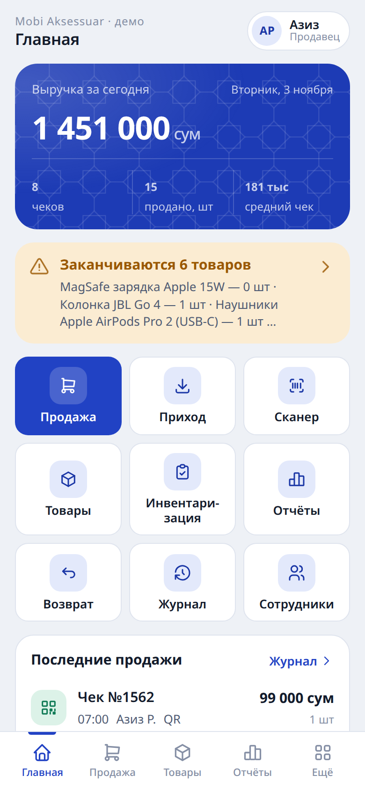
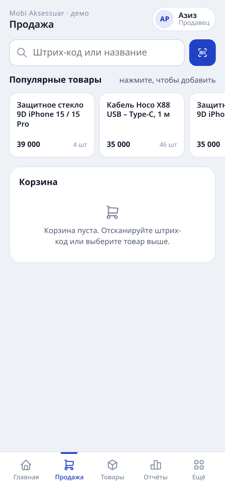
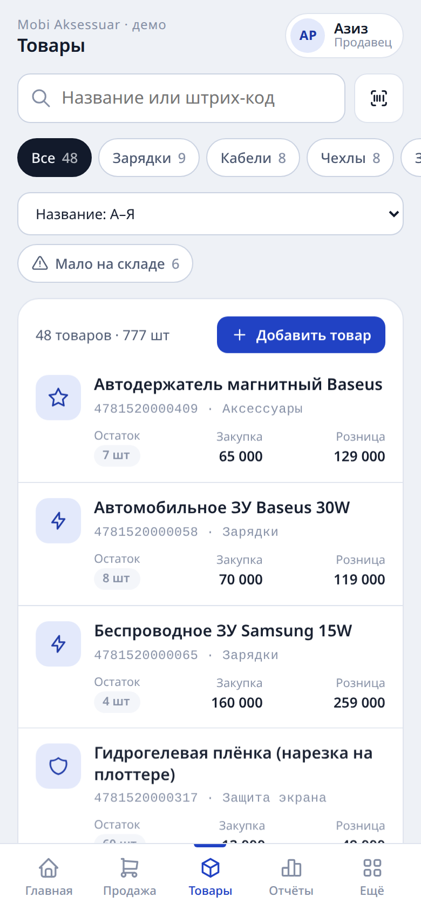
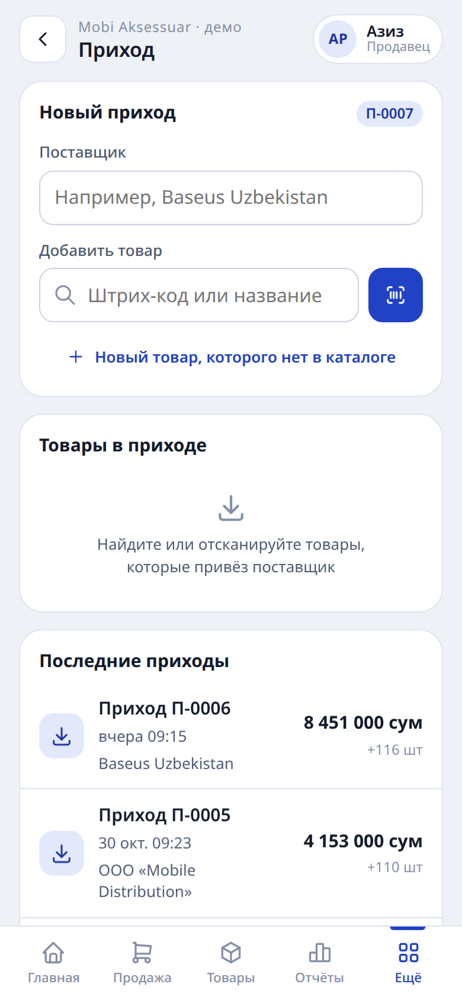
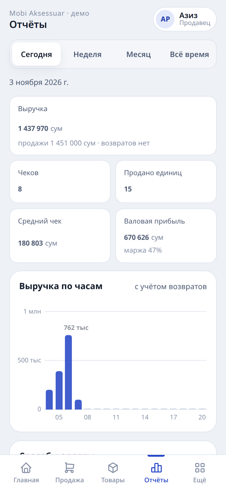
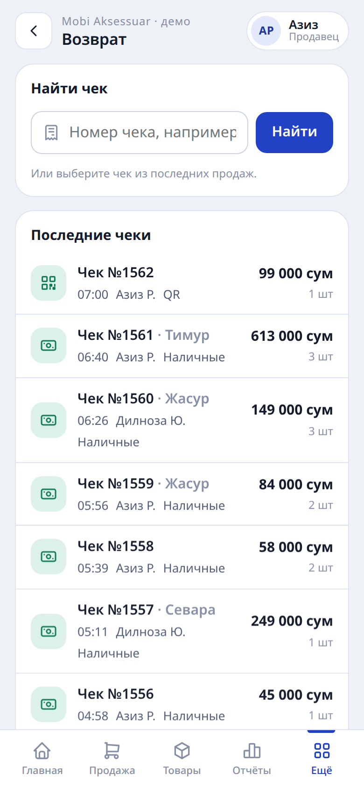

# Касса и склад

Веб-приложение для кассовых операций и складского учёта розничных магазинов аксессуаров для телефонов. Поддерживает работу нескольких магазинов в одной системе, прогнозирование остатков и оформление продаж при отсутствии связи. Интерфейс адаптирован для смартфона и планшета; для Android и iOS в репозитории лежат нативные приложения-обёртки.

**Демонстрационная версия:** https://asadbek8364-oss.github.io/kassa-demo/ — статичная сборка с тестовыми данными, открывается в браузере без установки и регистрации. Репозиторий демонстрации: https://github.com/asadbek8364-oss/kassa-demo

## Скриншоты

| Главная | Продажа | Товары |
|---|---|---|
|  |  |  |

| Приход | Отчёты | Возврат |
|---|---|---|
|  |  |  |

## Функциональность

- **Продажи.** Оформление чека: поиск по названию или штрих-коду, сканирование камерой устройства. Оплата: наличные, банковская карта, QR. Возврат — по ранее выданному чеку, с автоматическим возвратом товара на остаток.
- **Несколько магазинов.** Владелец создаёт магазины и переключается между ними; товары, документы, остатки и отчёты каждого магазина полностью изолированы. Для владельца доступна сводка по всем магазинам. Продавец работает только со своим магазином.
- **Прогнозы.** Расчёт выполняется на сервере по фактическим продажам за последние 28 дней с учётом тренда: на сколько дней хватит остатка по каждому товару, какое количество заказать, какие товары не продаются 30 и более дней и какая сумма в них заморожена.
- **Офлайн-режим.** При отсутствии связи продажи сохраняются в очередь на устройстве и автоматически отправляются на сервер при восстановлении соединения, без дублей чеков. Если к моменту отправки товара уже недостаточно, продажа не проводится и остаётся в очереди для ручной проверки.
- **Каталог и остатки.** Номенклатура с ценами и остатками; списание при продаже и оприходование при приёмке — автоматически. Товары с низким остатком выделяются на главном экране.
- **Приход и инвентаризация.** Регистрация поставок с обновлением остатков в момент проведения; сверка учётных остатков с фактическими, протокол расхождений.
- **Отчётность и журнал.** Выручка за день и период, количество чеков, средний чек, продажи в разрезе товаров; полная хронология операций с указанием сотрудника и времени.
- **Сотрудники и доступ.** Роли «владелец» и «продавец», вход по персональному PIN-коду; простые комбинации запрещены, после пяти неверных попыток доступ сотруднику временно блокируется.

## Мобильные приложения

- **Android** — проект на Kotlin (WebView) в каталоге `mobile/android`: полноэкранный режим, собственная иконка, сканер штрих-кодов, индикатор отсутствия сети. Сборка — в Android Studio.
- **iOS** — проект на Swift (WKWebView) в каталоге `mobile/ios`. Сборка — в Xcode на компьютере Mac.
- **PWA** — веб-версия устанавливается на главный экран телефона или планшета без магазинов приложений.

Подробно о мобильных проектах: `mobile/README.md` и `docs/kassa-mobile.md`.

## Ресторанная версия

Та же система для ресторана: три отдельных приложения, вход по тому же PIN, роль определяет интерфейс.

- **Админка** (`/admin`) — меню и стоп-лист, столики, сотрудники и их PIN, отчёты (выручка по дням, официантам и столикам, средний чек, популярные блюда), принтер кухни, режим сервера и синхронизация. Склад, приход и прогнозы — в «Кассе и складе».
- **Официант** (`/waiter`) — схема зала по статусам (свободен / занят / ждёт счёт), заказ на столик с комментариями к блюдам, отправка на кухню одной кнопкой, дозаказ, готовность с кухни, счёт гостю, оплата наличными или картой.
- **Кухня** (`/kitchen`) — полноэкранная доска «Новые → Готовятся → Готово» с таймерами по нормативу, звуком нового заказа и повторной печатью кухонного чека.
- **Печать на кухню** — сетевой ESC/POS-принтер (очередь с повторами при недоступности) или печать из браузера экрана кухни.
- **Два режима сервера** — локальный сервер в ресторане работает весь день без интернета; раз в день он отправляет заказы, продажи и движения склада на онлайн-сервер и получает оттуда меню, цены, столики, сотрудников и настройки.

Установка, синхронизация, принтер и ограничения: [`docs/restaurant.md`](docs/restaurant.md). Демо: `php artisan restaurant:demo --force` (при `KASSA_DEMO_ENABLED=true`).

## Развёртывание

Серверная часть — Laravel, база данных по умолчанию — SQLite. Пошаговая инструкция по установке и первой настройке: `docs/kassa-sklad.md`. При первом запуске выполняется мастер создания магазина: задаются название, владелец и его PIN-код; для запуска мастера требуется секретный код установки, который хранится только в настройках сервера.

## Лицензия

AGPL-3.0. Проект начинался с открытого каркаса Dikasir и был существенно переработан: серверная архитектура учёта, несколько магазинов, прогнозы, офлайн-режим и мобильные приложения разработаны заново.
